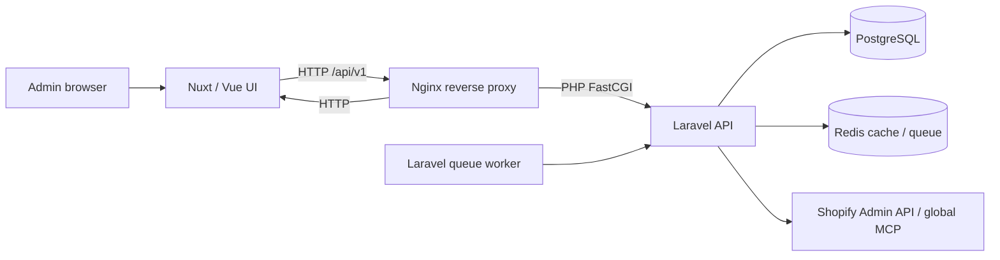
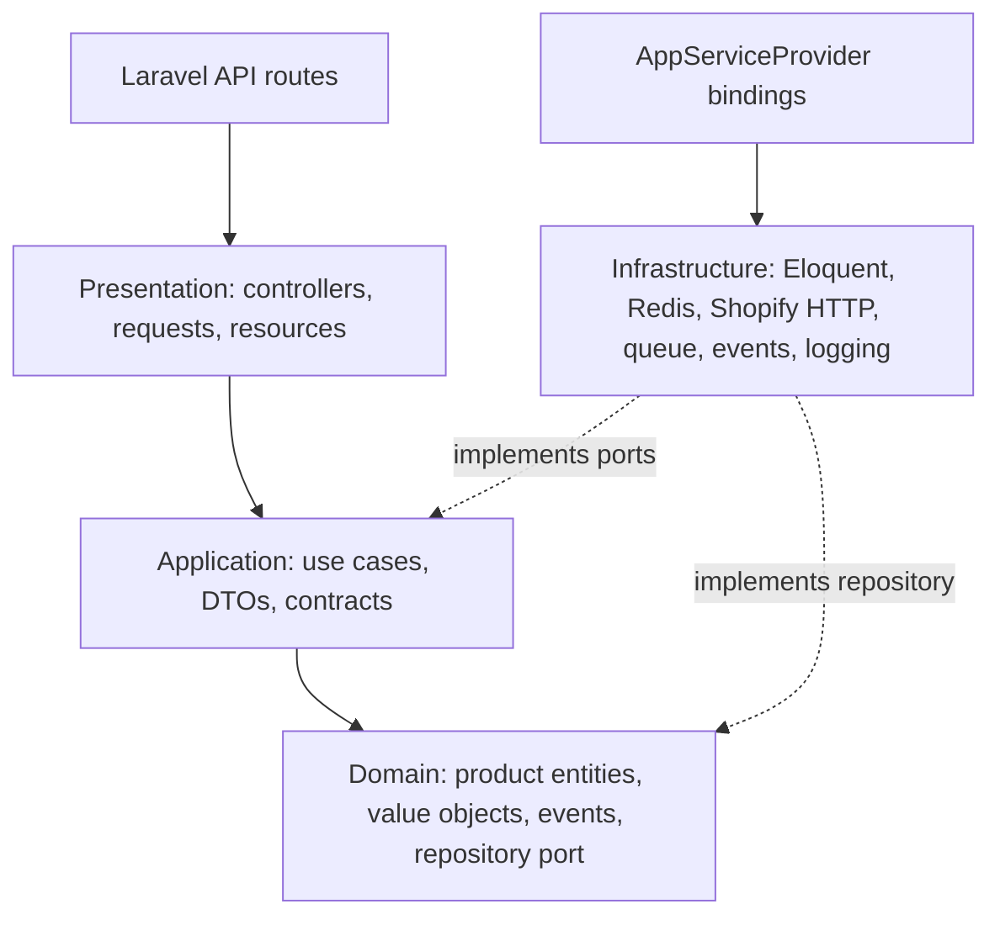
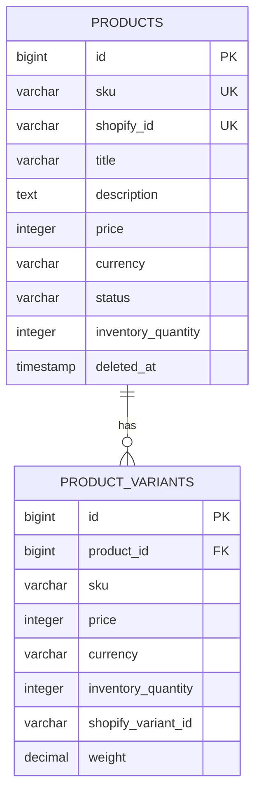

# Architecture — Shopify Integration

**Audited baseline:** `420fb6c1975e68b6d5353b1b6af5cfa69622d636` (`phase-3/audit-plan`). This document describes the inspected implementation, not a verified production deployment.

## System context

The frontend configuration points to a public API base URL (`NUXT_PUBLIC_API_BASE`). Nginx forwards `/api` to the Laravel public entry point and the other paths to Nuxt. Laravel uses PostgreSQL for product data and Redis for cache/queue. Shopify access is provided through an application contract and infrastructure client; a mock client is selected when `SHOPIFY_USE_MOCK` is enabled.

## Backend modules and dependency direction

`backend/src/Domain/Product` contains `Product`, `ProductVariant`, `Sku`, `Price`, `Currency`, `ProductStatus`, domain events/exceptions, and the repository interface. `backend/src/Application/UseCases/Product` contains sync, bulk import, product lookup, and inventory-update use cases. Presentation is versioned under `backend/src/Presentation/Http`. Infrastructure contains the Eloquent repository/models, Redis cache adapter, Laravel event/logger adapters, Shopify client/mock, and queue job. Laravel framework bootstrap/configuration remains in `backend/app`, `bootstrap`, `config`, and `routes`.

The Nuxt frontend is organized under `frontend/src`: `pages`, `components`, `composables`, Pinia `stores`, `types`, `utils`, assets, and unit tests. Product and sync stores call the `/api/v1` endpoints with `$fetch`.

## API surface observed

The following routes are declared in `backend/routes/api.php`; no authentication or role middleware is attached.

| Method and path | Request / behavior | Response behavior |
|---|---|---|
| `GET /api/v1/products` | `page`, `per_page` query parameters; list is cached for 300 seconds. | `ProductCollection` with `data` and `meta` (`total`, `page`, `perPage`, `lastPage`). |
| `GET /api/v1/products/{sku}` | Loads one product and variants. | `ProductResource`, or 404. |
| `DELETE /api/v1/products/{sku}` | Soft-deletes the matching product model. | Success message; current repository/controller do not signal a missing SKU. |
| `POST /api/v1/sync/product` | `shopify_id`, optional `force_update`. | 201 with a product resource; catches sync failure as 400. |
| `POST /api/v1/sync/bulk` | 1–100 `shopify_ids`, optional `skip_duplicates`; dispatches jobs. | 202 with message and count. |
| `POST /api/v1/sync/bulk/immediate` | 1–100 IDs; sequential use-case loop. | `BulkImportResult` keys are camelCase (`successCount`, `failedCount`, `totalProcessed`, etc.). |
| `PUT /api/v1/inventory` | SKU, non-negative integer quantity, optional reason. | Message, SKU, and quantity; no product `data` envelope. |
| `GET /api/v1/health` | Laravel API route. | Static `{"status":"ok"}`. Laravel also configures `/api/health`. |

There is no checked-in OpenAPI contract. API request validation exists for sync, bulk-sync, and inventory updates, but `authorize()` allows all callers and listing pagination is not bounded at the route/controller boundary.

## Data model and persistence

Two migrations create `products` and `product_variants`. Product SKU and nullable Shopify ID are unique. Product indexes cover status, creation time, and `(status, inventory_quantity)`. Variant rows have an FK to products with cascade on hard delete, unique `(product_id, sku)`, and an index on Shopify variant ID. Product models use soft deletes; that does not invoke the FK cascade. Monetary amounts are integer minor units and currency is stored separately; the Shopify conversion currently assumes USD.

`findAll()` and product lookup methods eager-load variants, so the common read paths do not show an obvious per-product relationship N+1. `save()` performs a product `updateOrCreate` followed by one variant `updateOrCreate` per incoming variant. Parent and child writes are not transaction-wrapped, and variants absent from an update payload are not removed. There is no outbox or explicit cross-service transaction. Queue/failed-job persistence is configured to Redis/database settings, but application migrations for those tables are not present in the two tracked migrations.

Backup and restore are shell scripts invoking PostgreSQL tools through Compose. Paths/database identifiers are fixed in the scripts; no encryption, off-host copy, or automated restore proof is present.

## Configuration and integrations

Backend configuration is read from `.env.example` / `.env.prod.example` and Laravel config:

- Application: `APP_ENV`, `APP_KEY`, `APP_DEBUG`, `APP_URL`, log settings.
- Database/cache/queue/session: `DB_*`, `REDIS_*`, `CACHE_DRIVER`, `QUEUE_CONNECTION`, `SESSION_DRIVER`.
- Shopify: `SHOPIFY_API_KEY`, `SHOPIFY_API_SECRET`, `SHOPIFY_STORE_DOMAIN`, `SHOPIFY_ACCESS_TOKEN`, `SHOPIFY_API_VERSION`, `SHOPIFY_WEBHOOK_SECRET`, `SHOPIFY_SAVED_CATALOG`, `SHOPIFY_USE_MOCK`.
- Frontend: `NUXT_PUBLIC_API_BASE`.
- Production Compose interpolation includes Docker registry/username, database settings, Redis password, and API base URL.

The example files contain placeholders rather than a live key. Development Compose has fixed example DB credentials. No actual secret was detected in the working-tree gitleaks scan. There is no `.dockerignore` in the build contexts, so the build context can include a local `.env` or other non-Git-ignored files.

The Shopify client supports Admin REST calls and a global MCP fallback. The MCP path obtains an OAuth token but the request header is a literal masked placeholder; this is a confirmed code-path defect. The client also logs request/response data at debug level; logging scope should be reviewed for sensitive catalog content.

## Runtime topology and CI

Development Compose defines backend, queue worker, frontend, Nginx, PostgreSQL, and Redis. Production Compose uses backend/frontend image tags set to `latest`, builds Nginx locally, and has persistent DB/Redis volumes. Nginx configuration is HTTP-only and routes API/PHP and Nuxt traffic. No Docker verification was run for this audit.

GitHub Actions has separate CI and build/deploy workflows. CI currently covers backend Unit tests, frontend Vitest and type-check, and frontend lint (marked continue-on-error). CI branch filters list `main` and `develop`, whereas the local origin HEAD observed during this audit is `master`. The build/deploy workflow builds and pushes on branch pushes and tags. There is no Docker test stage, comprehensive security gate, or measured runner-time evidence in this audit.

## Testing

The repository contains 12 backend test files (Unit, Feature, Integration) plus a shared test base, and four frontend Vitest files. PHPUnit declares coverage output for `src` with Eloquent models excluded; Vitest config declares v8 text/JSON/HTML reports. No coverage report was generated, no threshold is configured in the inspected Vitest config, and there are no tracked Playwright E2E specs/config despite the package script.

Several backend feature/integration assertions are statically inconsistent with controller/resource output (see `docs/REPOSITORY_AUDIT.md`). PHPUnit is configured with SQLite in `phpunit.xml`, while `config/database.php` has only PostgreSQL connections; CI overrides DB environment settings for its Unit job. PHP/Composer were unavailable on the host, and no Docker test/build was run, so no test pass/fail or coverage claim is made.

## Security and architecture decisions

- API authn/authz, rate limiting, and explicit CORS policy are absent; mutating routes are publicly reachable if the service is exposed.
- No live credential was detected by the redacted working-tree scan. Full Git-history scanning remains a Phase 4 task.
- KISS/YAGNI remain the default. Keep the existing domain/application/infrastructure seams where they support the real DB, cache, queue, and Shopify boundaries. Add transactions, outbox, or additional abstractions only if Phase 8/9 evidence shows they are needed; explain each application in an ADR.
- No intentional behavior or public API change was made during Phase 3.
